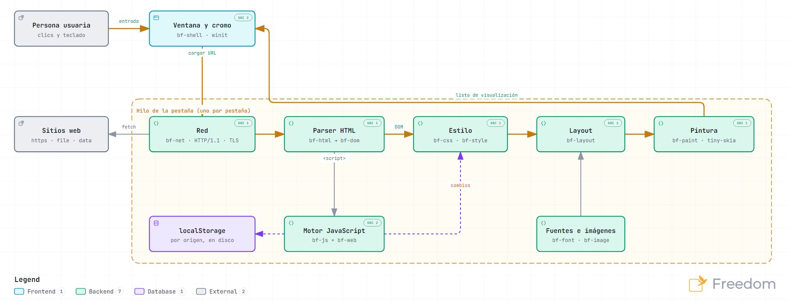
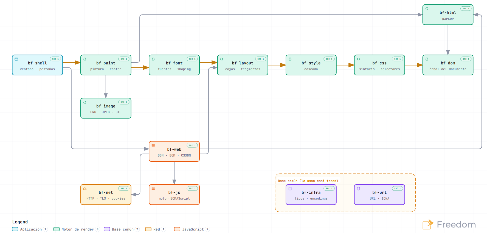

# Freedom


**Navega libre.** Freedom es un navegador web independiente: no está construido sobre Chrome,
Firefox ni Safari, sino sobre un motor propio, hecho desde cero.

> **Vista previa.** Freedom ya abre y muestra páginas web, y su JavaScript está en
> construcción: ejecuta los scripts de las páginas, pero todavía faltan muchas de las funciones
> que usan los sitios. Los sitios para leer (Wikipedia, blogs, noticias, documentación) se ven
> bien; los muy interactivos (redes sociales, correo web, mapas, tiendas) todavía no funcionan
> o se ven incompletos.

## Instalar Freedom

Descarga el instalador para tu sistema (Windows, macOS o Linux) desde
[Releases](https://github.com/ramirezjhulian7/browser-freedom/releases); cada release explica
cómo instalarlo.

También puedes compilarlo desde el código fuente, en cuatro pasos:

1. Instala Rust con el instalador oficial de [rustup.rs](https://rustup.rs) (en Windows,
   acepta las opciones por defecto).
2. Descarga Freedom: en [GitHub](https://github.com/ramirezjhulian7/browser-freedom), «Code →
   Download ZIP» y descomprímelo, o con git:

   ```sh
   git clone https://github.com/ramirezjhulian7/browser-freedom.git
   ```

3. Abre una terminal en esa carpeta y compílalo (tarda unos minutos la primera vez):

   ```sh
   cargo build --release -p bf-shell
   ```

4. Abre Freedom: es `target/release/freedom` (en Windows, `target\release\freedom.exe`; puedes
   abrirlo con doble clic y anclarlo a la barra de tareas).

Para abrir una página o un archivo directamente: `freedom https://es.wikipedia.org` o
`freedom pagina.html`.

## Cómo se usa

- **Ir a un sitio o buscar:** escribe en la barra de arriba (o directamente en la página de
  inicio) y presiona `Intro`. Si lo que escribes no parece una dirección, Freedom lo busca en
  Google.
- **En macOS** los atajos usan `Cmd` (⌘) donde Windows y Linux usan `Ctrl`: `⌘T`, `⌘C`,
  `⌘L`… La tabla de abajo tiene las dos columnas.
- **Pestañas:** `Ctrl+T` abre una y `Ctrl+W` la cierra. El clic central o `Ctrl+clic` en un
  enlace lo abre en otra pestaña.
- **Copiar y pegar:** arrastra para seleccionar texto; doble clic selecciona una palabra y
  triple clic un párrafo. `Ctrl+C` copia y `Ctrl+V` pega, también en la barra de direcciones y
  en los formularios. El clic derecho muestra más opciones (copiar enlaces, guardar imágenes).
- **Zoom:** `Ctrl` `+`, `Ctrl` `−` y `Ctrl` `0`, o `Ctrl` + rueda del ratón.
- **Tema claro u oscuro:** Freedom sigue el de tu sistema.

| Windows y Linux | macOS | Qué hace |
|---|---|---|
| `Ctrl+L` | `⌘L` | Ir a la barra de direcciones |
| `Ctrl+T` · `Ctrl+W` | `⌘T` · `⌘W` | Pestaña nueva · cerrar pestaña |
| `Ctrl+N` | `⌘N` | Ventana nueva |
| `Ctrl+Tab` · `Ctrl+1…9` | `⌃Tab` · `⌘1…9` | Cambiar de pestaña |
| `Alt+←` · `Alt+→` | `⌘[` · `⌘]` | Atrás · adelante |
| `Ctrl+R` · `F5` | `⌘R` · `F5` | Recargar |
| `Esc` | `Esc` | Detener la carga |
| `Alt+Inicio` | `⇧⌘H` | Página de inicio |
| `Ctrl+H` · `Ctrl+J` | `⌘Y` · `⌘J` | Historial · descargas |
| `Ctrl+D` · `Ctrl+Shift+B` | `⌘D` · `⇧⌘B` | Guardar marcador · ver los marcadores |
| `Ctrl+F` | `⌘F` | Buscar en la página |
| `Ctrl++` · `Ctrl+−` · `Ctrl+0` | `⌘+` · `⌘−` · `⌘0` | Acercar · alejar · tamaño normal |
| `Ctrl+A` · `Ctrl+C` · `Ctrl+V` | `⌘A` · `⌘C` · `⌘V` | Seleccionar todo · copiar · pegar |
| `Espacio` · `Mayús+Espacio` | `Espacio` · `⇧+Espacio` | Bajar · subir una pantalla |

En macOS el historial va en `⌘Y` porque `⌘H` oculta la aplicación (y `⌘Q` la cierra), como en
cualquier programa del Mac.

### Tu privacidad

- El historial existe solo mientras Freedom está abierto y se borra al cerrarlo. Las cookies
  de sesión también se borran al cerrar; las cookies persistentes (las que el sitio guarda con
  fecha de caducidad) se conservan hasta que caducan, como en cualquier navegador, así que
  algunas sesiones iniciadas en los sitios siguen abiertas al volver.
- Freedom guarda en tu equipo, como cualquier navegador:
  - las cookies persistentes y la lista de sitios que exigen HTTPS (HSTS), en la carpeta del
    perfil (`cookies.txt`, `hsts.txt`);
  - la caché de páginas e imágenes descargadas (hasta 512 MB);
  - el almacenamiento local de los sitios (`localStorage` e IndexedDB).

  Las carpetas de cada sistema están en [Plataformas](#plataformas).

  Para borrar todo eso, elimina esas carpetas con Freedom cerrado. Fuera de eso, Freedom solo
  escribe archivos cuando tú lo pides, como al guardar una imagen.
- No envía datos de uso: solo se conecta a los sitios que visitas (y a Google cuando buscas).
- Se presenta ante los sitios como lo que es, Freedom: no se hace pasar por Chrome ni por
  otro navegador.

### Qué funciona y qué todavía no

- **Funciona:** páginas hechas con HTML y CSS, con su texto, imágenes PNG, JPEG, GIF y APNG
  animados, WebP, BMP, ICO y SVG, tablas y la mayoría de los diseños (también texto de derecha
  a izquierda, como árabe y hebreo); enlaces, pestañas, atrás y adelante; formularios simples
  (buscar, escribir y enviar); zoom; copiar y pegar; los scripts de las páginas, con buena
  parte de las funciones del navegador que usan.
- **Todavía no:** parte de las funciones de JavaScript que usan los sitios, animaciones y
  transformaciones de CSS, video y audio, imágenes AVIF, favoritos, historial que se conserve
  al cerrar y descargas de archivos. El plan está en
  [`docs/roadmap.md`](docs/roadmap.md).

### ¿Algo no funciona?

Abre un reporte en
[GitHub Issues](https://github.com/ramirezjhulian7/browser-freedom/issues) con la dirección
de la página y lo que esperabas ver. Si apareció una página de error, copia el detalle que
muestra.

---

## Para desarrolladores

Freedom tiene un motor 100% propio, escrito en Rust. No usa Chromium, WebKit, Gecko ni Servo:
HTML, DOM, CSS, layout, pintura, URLs, red y JavaScript están escritos desde cero. Cada subsistema sigue su especificación (WHATWG, W3C, IETF, Unicode, ECMA) al pie de la
letra, y la compatibilidad se mide con las suites de pruebas oficiales.

El repositorio y los crates conservan el prefijo histórico `bf-` (de *browser-freedom*); el
ejecutable se llama `freedom` y es el binario del paquete `bf-shell`.

La **fase 1** está cerrada: el navegador carga y muestra páginas reales sin JavaScript (Google,
Wikipedia, Hacker News, example.com) en una ventana navegable con barra de URL, enlaces,
historial, scroll y zoom. La **fase 2** está en curso: el motor de JavaScript (`bf-js`) pasa el
95.3 % de test262 y ejecuta los scripts de las páginas en un hilo por pestaña, con workers;
las interfaces del DOM (con Shadow DOM y custom elements), de HTML, del navegador, de red y
del CSSOM (`bf-web`) se están completando. De las **fases 3 y 4** ya están tablas, grid,
tamaños intrínsecos, bidi y cortes de línea de Unicode, encodings multibyte, HTTP/2 con caché
HTTP en disco, SVG y WebP, y scroll containers con `sticky`; faltan, entre otros, `transform`
y las animaciones de CSS, la escritura vertical y AVIF. Lo hecho y lo que falta, apartado por
apartado y con sus cifras, está en [`docs/roadmap.md`](docs/roadmap.md).

## Estado por subsistema

| Subsistema | Spec | Suite oficial | Resultado |
|---|---|---|---|
| Tokenizador HTML | HTML §13.2.5 | html5lib-tests (tokenizer) | **7045** pasan, 0 fallan (3 *stale*) |
| Tree construction | HTML §13.2.6, §13.4 | WPT `html/syntax/parsing` | **3900** pasan, 0 fallan (4 omitidos) |
| CSS Syntax | CSS Syntax 3 | css-parsing-tests | **253** pasan, 0 fallan (24 *stale*) |
| URL e IDNA | URL Standard, UTS #46 | WPT `url/resources` | **1444** pasan, 0 fallan (7 omitidos: encoders multibyte) |
| Layout y pintura | CSS 2.2, Backgrounds 3, Flexbox 1, Grid 2, Tables 3, UI 4, Selectors 4, SVG 2 | WPT reftests (17 directorios) | **5583 / 7585 ejecutables (73.6%)** |
| APIs web | DOM, Shadow DOM, HTML, URL, Encoding, Console | WPT testharness.js (12 directorios, [`docs/wpt-status.md`](docs/wpt-status.md)) | **163 951 / 181 458 subtests (90.4%)** sin `encoding/legacy-mb-*` |
| Parser de JavaScript | ECMA-262 2026 §12–16, Annex B | test262-parser-tests | **3332** pasan, 0 fallan (48 *stale*) |
| Parser de JavaScript | ECMA-262 2026 | test262 (solo parsing, [`docs/test262-status.md`](docs/test262-status.md)) | **51 490** pasan, 0 fallan (527 omitidos: propuestas) |
| Motor JavaScript | ECMA-262 2026 | test262 (ejecución, [`docs/test262-status.md`](docs/test262-status.md)) | `language/` **99.95%**; total **95.3%** (48 791 / 51 220) |

- *stale*: casos cuya expectativa quedó desactualizada respecto del spec vigente. Se listan en
  cada test con el motivo.
- *omitidos*: casos de scripting o de encodings multibyte.
- Los encodings multibyte (japonés, coreano y chino) ya se decodifican y codifican; lo que no
  pasa de `encoding/legacy-mb-*` son los tests que cargan un `<iframe>` o envían un formulario
  a uno. Con ellos, el total es 381 570 / 949 176 subtests.

Detalle de los reftests por directorio (fuente: [`docs/wpt-status.md`](docs/wpt-status.md)):

| Directorio | pass | fail | needs-js | % de los ejecutables |
|---|---:|---:|---:|---:|
| css/CSS2/box-display | 70 | 16 | 53 | 81.4% |
| css/CSS2/margin-padding-clear | 659 | 23 | 57 | 96.6% |
| css/CSS2/normal-flow | 652 | 42 | 162 | 93.9% |
| css/CSS2/floats | 77 | 23 | 25 | 77.0% |
| css/CSS2/floats-clear | 186 | 25 | 36 | 88.2% |
| css/CSS2/positioning | 459 | 54 | 65 | 89.5% |
| css/CSS2/linebox | 176 | 14 | 53 | 92.1% |
| css/CSS2/text | 350 | 31 | 182 | 91.9% |
| css/CSS2/colors | 19 | 0 | 3 | 100.0% |
| css/CSS2/borders | 498 | 6 | 258 | 98.8% |
| css/CSS2/tables | 246 | 4 | 889 | 98.4% |
| css/css-backgrounds | 321 | 295 | 334 | 52.0% |
| css/css-flexbox | 633 | 316 | 478 | 66.7% |
| css/css-tables | 102 | 36 | 164 | 73.9% |
| css/css-grid | 635 | 930 | 913 | 40.5% |
| css/css-ui | 75 | 37 | 1097 | 67.0% |
| css/selectors | 107 | 13 | 404 | 89.2% |
| svg | 318 | 133 | 971 | 70.5% |

`needs-js` son los reftests con `<script>` o testharness.js: el harness de reftests todavía no
los ejecuta. Los de testharness.js de las APIs web se miden aparte (fila «APIs web» de la
tabla de estado). Mediciones posteriores por grupo (mismo WPT, en `docs/wpt-status.md`):
`css/css-flexbox` 699 / 949 (73.7%) y `css/css-grid` 1054 / 1567 (67.3%, con `grid-lanes`
518 / 851) tras E5; `css/css-overflow` 61.8% y `css/css-position/sticky` 10 / 11 (E12);
`css/CSS2/bidi-text` 79.0% y `css/css-text` 59.2% (E9).

### Qué implementa cada crate

- **`bf-url`**:
  - URL Standard completo: la máquina de estados con *state override*, los setters de la API
    `URL`, serialización y origin;
  - hosts IPv4 (con formas legacy), IPv6 y opacos;
  - dominios con UTS #46 (CheckBidi, CheckJoiners) y Punycode propios;
  - `application/x-www-form-urlencoded`, `URLSearchParams` y `data:` URLs.
- **`bf-infra`**:
  - `ResourceLoader` por `Url` y `FileLoader` (`file:`, `data:` y prefijos montados);
  - WHATWG Encoding: 228 etiquetas, BOM, UTF-8, UTF-16 y los 28 single-byte. Los multibyte
    se reconocen y se decodifican como windows-1252 (fase 3).
  - `identity`: cómo se presenta Freedom a los sitios (`User-Agent`, Client Hints,
    `navigator.platform`); ver [Identidad](CONTRIBUTING.md#identidad-del-navegador).
- **`bf-net`**:
  - HTTP/1.1 sobre TCP y TLS (rustls, webpki-roots, SNI, ALPN `http/1.1`), con timeouts de
    10 s (conexión) y 30 s (lectura) y pool keep-alive;
  - cuerpos con `Content-Length`, chunked y hasta EOF; gzip, deflate y br;
  - redirecciones de Fetch (hasta 20) y cookies RFC 6265bis en memoria;
  - detección del encoding de documentos: BOM → `Content-Type` → prescan de `<meta>` →
    windows-1252.
- **`bf-html`**:
  - tokenizador (§13.2.5) y tree builder (§13.2.6, los 21 insertion modes, contenido foráneo);
  - parseo de fragmentos (§13.4);
  - parser XML para XHTML.
- **`bf-dom`**: arena de nodos, mutaciones y el comportamiento de
  `select`/`option`/`selectedcontent` (selectedness, opciones, etiquetas).
- **`bf-css`**:
  - CSS Syntax 3 (con la gramática de nesting) y Selectors 4 (parser, especificidad, matching);
  - Media Queries 4;
  - el modelo de hojas: `@media`, `@supports`, `@layer`, `@import`, `@namespace`,
    `@font-face`, `@keyframes` y `@page`.
- **`bf-style`**:
  - cascada (Cascade 5 con capas, `revert` y `revert-layer`) y custom properties con `var()`;
  - CSS Values 4 (`calc()`, `min()`, `max()`, `clamp()`) y CSS Color 4 (incluido
    `light-dark()`);
  - un registry único de propiedades;
  - la hoja UA transcrita de HTML §15 y los presentational hints;
  - `<link rel=stylesheet>` y `@import`.
- **`bf-font`**:
  - fuentes del sistema (Windows, Linux, macOS) y `@font-face` (`url()`, `local()`,
    `unicode-range`);
  - matching de CSS Fonts 4 §5, fallback por carácter, shaping con `rustybuzz` y contornos.
- **`bf-image`**: PNG, JPEG y GIF (primer cuadro) con sniffing de firmas.
- **`bf-layout`**:
  - árbol de cajas; BFC con colapso de márgenes y `clear`; floats;
  - inline: quiebre de líneas, `vertical-align`, `white-space`, `text-align`;
  - posicionamiento `relative`, `absolute` y `fixed`;
  - reemplazados con relación de aspecto;
  - Flexbox 1 §9 completo;
  - controles de formulario de HTML §15.5 y `fieldset`/`legend` (§15.3.13);
  - `align-content` en block containers.
- **`bf-paint`**:
  - lista de visualización según CSS 2.2 Apéndice E: stacking contexts, `opacity`, recortes,
    `position: fixed` fuera del scroll;
  - bordes con todos los estilos y radios, decoraciones de texto;
  - imágenes y capas de `background-image`;
  - partes nativas de los controles;
  - rasterizado con `tiny-skia` y el harness de reftests de WPT.
- **`bf-shell`**: el navegador (ejecutable `freedom`). Un hilo por pestaña carga, ejecuta los
  scripts y maqueta; la ventana, cuya interfaz dibuja el propio motor, muestra el resultado:
  panel del motor, superposición de cajas y páginas `about:` (ver [La interfaz](#la-interfaz)).
- **`bf-js`** (fase 2, en curso): el motor de ECMAScript 2026:
  - lexer (§12) con identificadores Unicode, números correctamente redondeados, templates y
    re-escaneo de regex dirigido por el parser;
  - parser con las cover grammars, ASI, Annex B y todos los early errors;
  - validador de la sintaxis de RegExp (§22.2.1, modos `u` y `v`);
  - AST con la forma de ESTree (`bf-js dump-ast archivo.js [--module]`);
  - `JsString` UTF-16;
  - compilador a bytecode con resolución de ámbitos, VM de pila y heap con GC mark-sweep
    sobre arenas indexadas (raíces explícitas y `HandleScope`);
  - built-ins: Object, Function, Boolean, Symbol, Error y los NativeError, Number, Math,
    String (la ruta sin RegExp), Array, Iterator (con los iterator helpers, `concat`, `zip`,
    `chunks`/`windows`), JSON, Reflect, Proxy y las funciones globales (`parseInt`,
    `encodeURI`, `escape` de Annex B…);
  - módulos ECMAScript (§16.2): Source Text Module Records, ResolveExport con ciclos y
    ambigüedad, Link y Evaluate (Tarjan del spec), bindings de import vivos, el namespace
    exótico, `export * as ns`, módulos JSON (`with { type: "json" }`), `import.meta`,
    `import()` dinámico (también desde scripts y `eval`) y top-level await;
  - `bf-js run archivo.js [--module]` ejecuta un script o un módulo (con sus imports desde
    el sistema de archivos) con `print`.
- **`bf-web`** (fase 2, en curso): el puente entre `bf-js` y la plataforma web. Las interfaces
  WebIDL del DOM, de HTML, del BOM (`navigator`, `location`, `history`, storage…) y del CSSOM
  como clases host de JavaScript, más el runner de testharness.js de WPT.

## Arquitectura

<picture>
  <source media="(prefers-color-scheme: dark)" srcset="docs/arquitectura-dark.png">
  
</picture>

La versión interactiva, con zoom, búsqueda, recorridos guiados («Cargar una página» y
«JavaScript») y enlaces al código de cada parte, es
[`docs/arquitectura.html`](docs/arquitectura.html): descárgala y ábrela en un navegador. Se
genera desde [`docs/arquitectura.json`](docs/arquitectura.json) con asimetrix-arq-generator
y la identidad de Freedom (ver [`tools/arquitectura/`](tools/arquitectura/README.md)).

Freedom trabaja con **dos clases de hilos**:

- **La interfaz** (`bf-shell`, `window/`): la ventana, el cromo, la entrada del usuario y el
  raster de la lista de visualización. Nunca espera a la red ni a los scripts.
- **Un hilo por pestaña** (`window/worker.rs`): dueño del documento y de su motor de
  JavaScript (`script.rs`). Carga, parsea ejecutando los scripts, calcula estilos, maqueta y
  arma la lista de visualización; corre los temporizadores y, si los scripts cambian el DOM,
  vuelve a maquetar (como mucho un cuadro cada 16 ms). Los clics y las teclas le llegan como
  eventos del DOM (`window/events.rs`).

El flujo de una página:
1. La ventana manda la URL al hilo de la pestaña.
2. `bf-net` la resuelve con `bf-url`, hace el fetch (HTTP/1.1, TLS) y elige el encoding.
3. `bf-html` parsea a un árbol `bf-dom`. Cada `<script>` lo ejecuta `bf-js` con las
   interfaces de `bf-web` (DOM, BOM, CSSOM); `localStorage` se guarda por origen en disco.
4. `bf-style` carga las hojas (UA, autor, `@import`) con `bf-css` y calcula los valores
   computados de cada elemento.
5. `bf-layout` construye el árbol de cajas y produce un árbol de fragmentos con geometría
   absoluta. Para eso usa `bf-font` (métricas y glifos) y los tamaños de `bf-image`.
6. `bf-paint` lo convierte en una lista de visualización, que vuelve a la ventana: ahí se
   rasteriza y se compone con el cromo.

### Dependencias entre crates

<picture>
  <source media="(prefers-color-scheme: dark)" srcset="docs/dependencias-dark.png">
  
</picture>

Cada flecha va de un crate al que usa directamente, y solo se muestran las dependencias
necesarias: si A usa B y B usa C, la flecha de A a C se omite. `bf-infra` y `bf-url` los usan
casi todos y van aparte. Versión interactiva, con enlaces al `Cargo.toml` de cada crate:
[`docs/dependencias.html`](docs/dependencias.html) (se genera desde
[`docs/dependencias.json`](docs/dependencias.json), igual que el diagrama de arquitectura).

## Reglas del proyecto

- **Motor 100% propio.** Está prohibido depender de:
  - Chromium/Blink, WebKit, Gecko, Servo y sus crates (`html5ever`, `cssparser`,
    `selectors`, `style`, `script`, `webrender`);
  - motores JavaScript (`v8`, `boa`, `deno_core`, `rquickjs`, `quickjs`, SpiderMonkey, JSC);
  - `reqwest`, `hyper`, `ureq`, `url`, `idna`, `image`, `encoding_rs`, `taffy` y cualquier
    crate que implemente parsing de HTML/CSS/JS, URLs, encodings o layout;
  - `fontdb`, `font-kit`, `cosmic-text` y `skia-safe`: la base de fuentes, el matching, la
    lista de visualización y el pipeline de pintura son propios.
- **Crates de plataforma permitidos** (reemplazables):
  - ventana y presentación: `winit`, `softbuffer` (`wgpu` también permitido);
  - raster: `tiny-skia`;
  - TLS: `rustls` (con `ring` como proveedor criptográfico), `webpki-roots`,
    `rustls-pki-types`;
  - descompresión HTTP: `flate2`, `brotli`;
  - códecs de imagen: `png`, `zune-jpeg`, `gif`;
  - NFC para IDNA: `unicode-normalization`;
  - portapapeles y diálogos de archivo: `arboard`, `rfd`;
  - fuentes: `ttf-parser`, `rustybuzz`;
  - utilidades: `serde`/`serde_json` (solo tests y configuración), `tokio`, `thiserror`, `log`.

  Hoy se usan todos menos `wgpu`, `tokio`, `serde`, `thiserror` y `log` (`serde_json`, solo
  en los tests).
- **La compatibilidad se mide con suites oficiales**: html5lib-tests, web-platform-tests y
  (fase 2) test262. Ninguna funcionalidad se da por terminada sin su suite.
- **Spec literal**: el código sigue el texto del spec y cita la sección. Si un test contradice
  el spec vigente, se documenta en [`docs/wpt-status.md`](docs/wpt-status.md); no se agrega a
  una lista de omitidos sin explicación.
- `#![forbid(unsafe_code)]` en todos los crates.
- **Identidad propia.** Freedom da a los sitios los mismos datos que Chrome (sistema,
  arquitectura, idiomas, Client Hints), pero se identifica como Freedom, producto y motor: sin
  `AppleWebKit`, `Chrome` ni `Safari` en el `User-Agent`, sin marca `Chromium`, sin
  `vendor` de Google. Todo sale de `bf_infra::identity` (ver
  [`CONTRIBUTING.md`](CONTRIBUTING.md#identidad-del-navegador)).

Ver [`CONTRIBUTING.md`](CONTRIBUTING.md) para el flujo de trabajo.

Los instaladores y el proceso de release están en [`packaging/`](packaging/README.md).

## Compilar

Requiere Rust estable (edición 2024) y Python 3 solo para regenerar tablas.

```sh
cargo build --workspace --release
```

El ejecutable queda en `target/release/freedom` (`freedom.exe` en Windows).

## Plataformas

Freedom compila y funciona en Windows, macOS y Linux con el mismo código; lo que cambia es
dónde guarda sus datos, los atajos y las fuentes.

| Qué | Windows | macOS | Linux |
|---|---|---|---|
| Perfil: historial, marcadores, descargas, opciones, sesión, cookies, HSTS | `%LOCALAPPDATA%\Freedom` | `~/Library/Application Support/Freedom` | `$XDG_DATA_HOME/freedom` o `~/.local/share/freedom` |
| Caché HTTP | `%LOCALAPPDATA%\Freedom\cache` | `~/Library/Caches/Freedom` | `$XDG_CACHE_HOME/freedom` o `~/.cache/freedom` |
| `localStorage` · IndexedDB | `%APPDATA%\freedom\{storage,idb}` | `~/Library/Application Support/Freedom/{storage,idb}` | `~/.freedom/{storage,idb}` |
| Descargas y capturas | `%USERPROFILE%\Downloads` | `~/Downloads` | `XDG_DOWNLOAD_DIR` o `~/Downloads` |
| "Ver en carpeta" | Explorador, con el archivo seleccionado | Finder, con el archivo seleccionado (`open -R`) | la carpeta (`xdg-open`) |
| Fuentes | `%WINDIR%\Fonts` y las del usuario | `/System/Library/Fonts` (con `Supplemental`), `/Library/Fonts`, `~/Library/Fonts` | `/usr/share/fonts`, `/usr/local/share/fonts`, `~/.fonts`, `~/.local/share/fonts` |

`FREEDOM_PROFILE` cambia la carpeta del perfil (también la de las cookies y HSTS) y
`FREEDOM_DOWNLOADS` la de descargas, en cualquier sistema.

**Atajos.** El modificador primario es `Cmd` (⌘) en macOS y `Ctrl` en Windows y Linux; la tabla
está en `crates/bf-shell/src/window/keys.rs` y los menús y las páginas internas escriben cada
atajo como se usa en el sistema (`Ctrl+D` o `⌘D`). `Ctrl+Tab` cambia de pestaña en todos. En
macOS `⌘H` y `⌘Q` son del sistema (ocultar y salir), por eso el historial es `⌘Y`, y atrás y
adelante son `⌘[` y `⌘]` (`⌥←`/`⌥→` mueven el cursor por palabras). En las sesiones sin
ventana, `key:mod+t` usa el primario del sistema (`key:ctrl+…` y `key:cmd+…` son literales).

**Pantallas Retina y de alta densidad.** La ventana se pinta en píxeles físicos (el factor de
escala de la pantalla por el zoom), y ese producto es el `devicePixelRatio` de la página.

**Varios worktrees de git.** WPT y test262 pesan varios GB y no se versionan: en un worktree
nuevo se enlazan los del checkout principal en vez de descargarlos otra vez.

```sh
git worktree add ../browser-freedom-otro -b otra-rama
cd ../browser-freedom-otro
git submodule update --init                       # html5lib-tests, css-parsing-tests, test262-parser-tests
ln -s "$(git rev-parse --path-format=absolute --git-common-dir)/../tests/wpt" tests/wpt
ln -s "$(git rev-parse --path-format=absolute --git-common-dir)/../tests/test262" tests/test262
# `.gitignore` ignora las carpetas `tests/wpt/` y `tests/test262/`, no un enlace con ese nombre:
printf 'tests/wpt\ntests/test262\n' >> "$(git rev-parse --git-common-dir)/info/exclude"
```

Los enlaces son de solo lectura en la práctica: el checkout principal es el que se actualiza
con `tools/fetch-wpt.sh` y `tools/fetch-test262.sh`.

## Uso

`<url>` es una URL `http(s)://`, `file://`, `data:` o `about:`, o una ruta local.

```sh
# Ventana navegable (sin argumentos abre la página de inicio); --version imprime la versión
freedom
freedom https://es.wikipedia.org/wiki/Navegador_web
freedom open https://es.wikipedia.org/wiki/Navegador_web

# PNG de 1024×768 con tiempos por fase en stderr
freedom render https://www.google.com -o google.png --width 1024 --height 768
freedom render about:home -o home.png
freedom render "about:engine?https://www.google.com" -o motor.png --height 1100

# Volcados para depurar
freedom dump-dom https://example.com
freedom dump-css estilos.css
freedom dump-style pagina.html --selector "nav a"
freedom dump-layout pagina.html --width 800 --system-fonts

# La lógica de la ventana sin abrir una: un PNG por paso (con el cromo) y el estado en stdout
freedom session about:home "type:google.com" "key:enter" "key:mod+i" "key:f12"     "move:600,300" -o sesion
```

### La interfaz

- **Pestañas**: `Ctrl+T` abre una, `Ctrl+W` la cierra, `Ctrl+Tab`/`Ctrl+1…9` cambian; el clic
  central o `Ctrl+clic` en un enlace lo abre en otra pestaña, y cada pestaña conserva su
  historial, su scroll y su panel del motor.
- **Formularios**: los campos de texto y `<textarea>` se editan (caret, selección con Mayús,
  `Ctrl+A/C/X/V`), `Enter` en un campo envía el formulario (GET o POST `urlencoded`) y los
  botones de envío funcionan.
- **Selección de texto**: arrastrar selecciona, doble clic una palabra y triple clic el
  párrafo; `Ctrl+A` selecciona toda la página y `Ctrl+C` (o «Copiar» en el menú contextual)
  copia, con los saltos de línea suaves como espacios y un `\n` entre bloques. Dentro de un
  campo, arrastrar selecciona su texto. En sesiones sin ventana: `drag:x,y>x,y`,
  `dblclick:x,y` y `tripleclick:x,y`.
- **Menú contextual** (clic derecho): abrir enlaces o imágenes en otra pestaña, copiar sus
  direcciones, guardar una imagen o la página con un diálogo del sistema, cortar/copiar/pegar
  en un campo, ver el código fuente (`about:source?<url>`) e inspeccionar las cajas.
- **Logo**: `assets/freedom.png`. La marca vectorizada (`Icon::Brand`), sin fondo, es
  el icono de la ventana (barra de tareas, `Alt+Tab`) y la de la barra y las pestañas;
  `crates/bf-shell/assets/mark-256.png` es la misma marca sobre transparente para
  `about:home`.

## La interfaz (detalle)

La interfaz muestra lo que el motor hace con cada página, en lugar de imitar el cromo de otros
navegadores. La dibujan el propio motor y el propio rasterizador. La barra, la línea de estado,
el panel y las páginas internas son HTML generado con plantillas de `crates/bf-shell/pages/`.
Los iconos son paths. Todos los colores salen de un único `Theme`
(`crates/bf-shell/src/theme.rs`), y la identidad sale del logo — un marco con la esquina
superior derecha abierta por donde escapa un pájaro:

- **Paleta oscura («tinta»):** marco `#0E1117` (franja de pestañas y línea de estado), cromo
  `#161A22` (barra, pestaña activa, páginas internas), superficie `#1D222C`, texto
  `#ECEEF3`/`#8D94A6` y un único acento, el ámbar del logo `#F5A524`.
- **Paleta clara («papel»):** marco `#E8EAEF`, cromo `#F7F8FA`, superficie `#FFFFFF`, texto
  `#171A21`/`#5E6574`; el mismo ámbar, y como texto (enlaces) un ámbar tostado `#9A5B00` que
  cumple contraste AA.
- **Formas:** cuadrados redondeados como el marco del logo (botones, campo de URL, tarjetas).
- **El marco abierto:** el motivo del logo repetido en la interfaz — el trazo ámbar de la
  pestaña activa no llega a su esquina derecha, y los monogramas de `about:home` y la marca de
  `about:error` son marcos ámbar sin la esquina superior derecha (`.frame` en `style.css`).
- **Elección del tema:** sigue al del sistema; `BF_THEME=light|dark` lo fuerza.
- **Tipografía:** `system-ui`, 13 px en el cromo y 12 px en la línea de estado.

Sus partes:

- **Barra superior** (72 px: franja de pestañas de 34 y barra de herramientas de 38):
  - las pestañas: la activa se une a la barra; cada una lleva la marca (páginas `about:`), un
    globo (las demás) o un indicador ámbar que gira mientras carga;
  - la marca, ← → y ↻ (que pasa a ✕ mientras carga);
  - el campo de URL: sin foco, formateado (candado en `https`, aviso en `http`, la marca en
    `about:`, host destacado, esquema y ruta en gris); con foco, una lupa, borde ámbar y halo;
  - una línea de progreso ámbar a todo el ancho mientras carga;
  - el botón del **panel del motor**, con un punto ámbar si la página usó algo que el motor
    aún no soporta.
- **Panel del motor** (320 px, `Ctrl+I`):
  - tiempos por fase con barras: fetch, parse, estilo, imágenes, layout, pintura y raster;
  - el documento: URL final, redirecciones, HTTP, tipo, encoding y de dónde salió (BOM,
    cabecera, `<meta>`, default), modo quirks, tamaño, nodos DOM, hojas y reglas, imágenes,
    cookies;
  - lo que el motor ignoró, con contadores de `bf-style`, `bf-layout` y `bf-image`:
    `<script>`, propiedades CSS desconocidas con su frecuencia, valores no aceptados,
    at-rules sin efecto, `display` degradados, formatos de imagen sin decodificador y
    controles sin interactividad;
  - las fuentes resueltas;
  - botones para guardar PNG, volcar el layout y volcar el DOM (en la carpeta de
    descargas).
- **Línea de estado** (24 px): el destino del enlace bajo el puntero; zoom, viewport en px CSS
  y tiempo total de carga.
- **Menú contextual**: tarjeta con sombra, resaltado ámbar tenue y el atajo de cada acción a la
  derecha.
- **Superposición de cajas** (`F12`):
  - los fragmentos sobre la página: bloques en ámbar, inline en verde, texto en gris;
  - el fragmento bajo el puntero, resaltado y descrito como `<tag.class> tipo x,y w×h`.
- **Páginas internas**:

  | Página | Contenido |
  |---|---|
  | `about:home` | Inicio: búsqueda, accesos, historial reciente y la tabla de atajos. Escribir en ella va a la barra; lo que no parece una dirección se busca en Google. |
  | `about:engine` | El panel como página completa (`about:engine?<url>` analiza esa URL). |
  | `about:wpt` | El estado de compatibilidad de `docs/wpt-status.md`. |
  | `about:error` | Error de carga (DNS, TLS, timeout, conexión, HTTP 4xx/5xx), con "Reintentar". |
  | `about:` | El índice de las páginas internas. |

  Solo usan CSS que el motor soporta, y un test lo verifica.

| Atajo | Acción |
|---|---|
| `Ctrl+L`, `F6`, clic en el campo | Ir a la barra de dirección |
| `Intro` en la barra | Navegar (sin esquema, `https://`; una ruta, `file://`; si no, buscar) |
| `Ctrl+I` | Panel del motor |
| `F12` | Superposición de cajas |
| `Ctrl+R`, `F5` | Recargar |
| `Esc` | Detener la carga o volver a la página |
| `Alt+←` / `Alt+→`, botones ← →, botones laterales del ratón | Atrás / adelante |
| `Ctrl +`, `Ctrl -`, `Ctrl 0`, `Ctrl`+rueda | Zoom |
| `Ctrl+S` | Guardar un PNG de la ventana (con el cromo) |
| `Ctrl+Shift+D` | Volcar el layout |
| `Ctrl+H` | Inicio |
| rueda, flechas, `Re Pág`/`Av Pág`, `Inicio`/`Fin`, `Espacio`/`Mayús+Espacio` | Desplazar |

La carga (red, parseo, estilo, imágenes y layout) corre en un hilo de trabajo, así que la
ventana nunca se bloquea.

## Pruebas

| Suite | Ubicación | Cómo se obtiene |
|---|---|---|
| html5lib-tests (tokenizador) | `tests/html5lib-tests` | submódulo de git |
| css-parsing-tests | `tests/css-parsing-tests` | submódulo de git |
| WPT: `css`, `html`, `svg`, `dom`, `url`, `fetch`, `xhr`, `IndexedDB`, `workers`… (lista en `tools/fetch-wpt.sh`) | `tests/wpt` | `tools/fetch-wpt.sh` o `tools/fetch-wpt.ps1` |
| test262-parser-tests | `tests/test262-parser-tests` | submódulo de git |
| test262 (`harness`, `test/language`, `test/built-ins`, `test/annexB`, `test/intl402`) | `tests/test262` | `tools/fetch-test262.sh` o `tools/fetch-test262.ps1` |

WPT pesa varios GB. `tools/fetch-wpt` hace un clon parcial y sparse de los directorios que se
usan, en el commit pineado en `tools/wpt-commit.txt`. `tools/fetch-test262` hace lo mismo con
test262 (`tools/test262-commit.txt`). Ni `tests/wpt/` ni `tests/test262/` se versionan.

```sh
git submodule update --init                 # html5lib-tests, css-parsing-tests, test262-parser-tests
sh tools/fetch-wpt.sh                       # o: powershell -File tools/fetch-wpt.ps1
sh tools/fetch-test262.sh                   # o: powershell -File tools/fetch-test262.ps1

cargo test --workspace                      # todas las pruebas (sin los reftests), con muestras
BF_FULL=1 cargo test --workspace            # lo mismo, con las suites de test262 enteras
cargo test -p bf-html --test html5lib_tokenizer -- --nocapture       # resumen por archivo
cargo test -p bf-html --test wpt_tree_construction -- --nocapture
cargo test -p bf-css --test css_parsing_tests -- --nocapture
cargo test -p bf-url --test wpt_url -- --nocapture
cargo test -p bf-js --test parser_tests -- --nocapture         # test262-parser-tests
BF_FULL=1 cargo test -p bf-js --test test262_parse -- --nocapture   # parsing de test262 (escribe docs/test262-status.md)
cargo test -p bf-js --release --test fuzz -- --ignored --nocapture   # 1000 mutaciones sin pánico
cargo run --release -p bf-js --bin test262 -- tests/test262 --out docs/test262-status.md   # ejecución de test262
cargo test -p bf-js --release --test test262_run -- --ignored --nocapture   # regresión de language/
cargo run --release -p bf-web --bin wpt-testharness -- --out docs/wpt-status.md   # WPT testharness.js (dom, html/dom, url, encoding…)
cargo test -p bf-web --release --test wpt_testharness -- --ignored --nocapture   # WPT testharness.js sin pánicos
cargo test -p bf-layout --test layout       # 102 casos propios (BF_LAYOUT_PRINT=1 imprime)
cargo test -p bf-paint --test raster        # 14 PNG de referencia (UPDATE_EXPECTED=1 regenera)
cargo test -p bf-paint --test wpt_reftests -- --ignored --nocapture  # reftests (~1,5 min)
cargo run --release -p bf-paint --bin wpt-reftests -- css/css-flexbox   # un subconjunto
```

Sin la variable `BF_FULL`, los tests de `bf-js` que recorren corpus de test262
(`test262_parse`, `parser_tests` y `regexp_property_escapes`) prueban una muestra determinista:
1 de cada 50 archivos en orden de ruta, para que `cargo test --workspace` tarde minutos y no
horas. `test262_parse` lee su muestra de `crates/bf-js/tests/data/test262-sample.txt` en vez
de recorrer los ~52 000 archivos del árbol (recorrerlo cuesta minutos con el disco cargado).
Con `BF_FULL=1` recorren todo, y solo entonces `test262_parse` escribe su sección de
[`docs/test262-status.md`](docs/test262-status.md) y regenera ese índice (hay que hacerlo al
cambiar `tools/test262-commit.txt`; con un índice de otro commit, la muestra se saca
recorriendo el árbol). Los tests `#[ignore]` (reftests, fuzz,
regresión de test262) siguen igual: se corren con `--ignored`.

Los reftests no hacen fallar `cargo test`: escriben el resumen en
[`docs/wpt-status.md`](docs/wpt-status.md) y dejan en `target/reftests/` las imágenes de cada
fallo (`-actual`, `-expected`, `-diff`) y el detalle por test (`results.tsv`).

Tablas generadas (con `python -I`):

| Script | Fuente | Salida |
|---|---|---|
| `tools/gen_entities.py` | `crates/bf-html/data/entities.json` | entidades nombradas de HTML |
| `tools/gen_idna.py` | `crates/bf-url/data/` (IDNA 18.0, bidi, joining) | `crates/bf-url/src/tables.rs` |
| `tools/gen_encodings.py` | `crates/bf-infra/data/` (índices de WHATWG Encoding) | `crates/bf-infra/src/encoding_tables.rs` |
| `tools/gen_unicode_id.py` | `crates/bf-js/data/` (UCD 18.0: ID_Start/ID_Continue, Zs, alias de propiedades) | `crates/bf-js/src/lexer/unicode_tables.rs` |

Verificación completa antes de integrar cambios:

```sh
cargo build --workspace --release
cargo test --workspace
cargo clippy --workspace --all-targets -- -D warnings
cargo fmt --all --check
cargo test -p bf-paint --test wpt_reftests -- --ignored --nocapture
```
